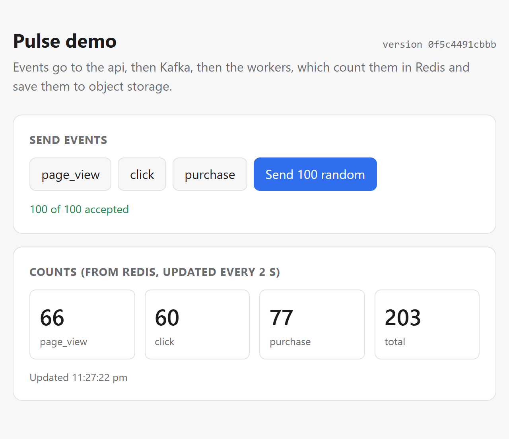
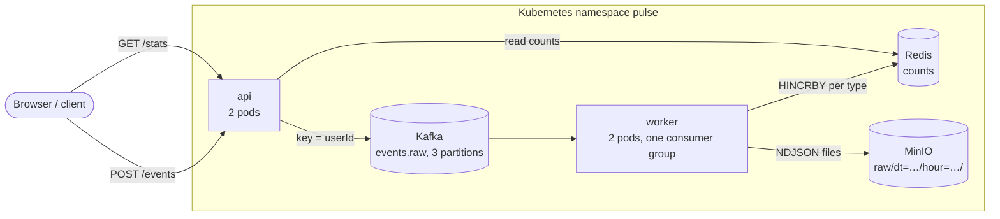
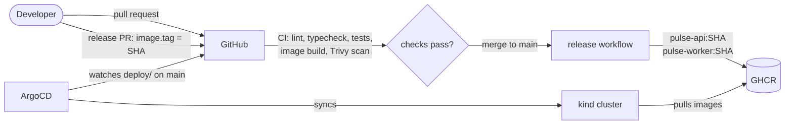
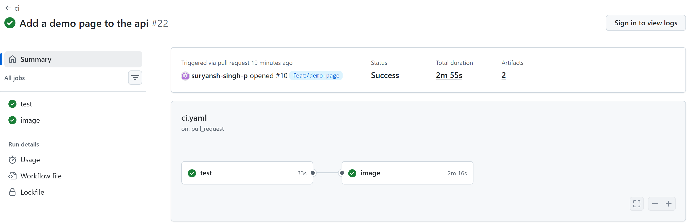
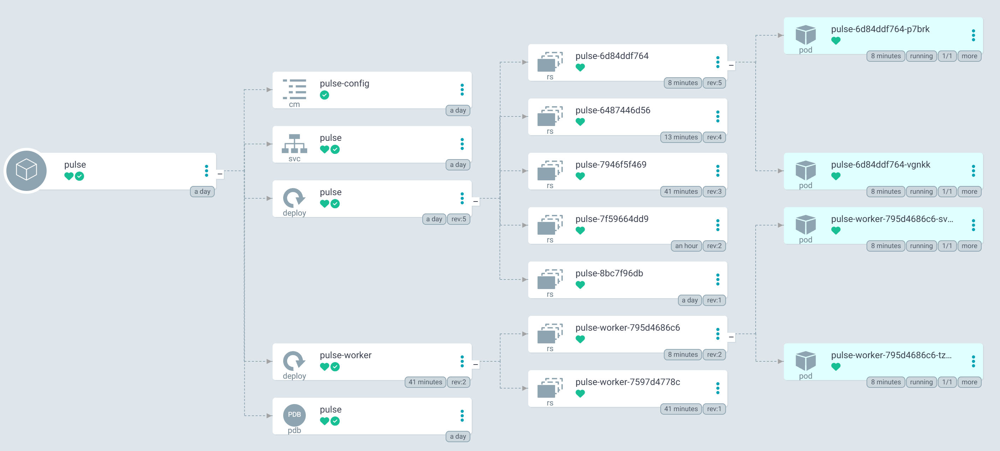
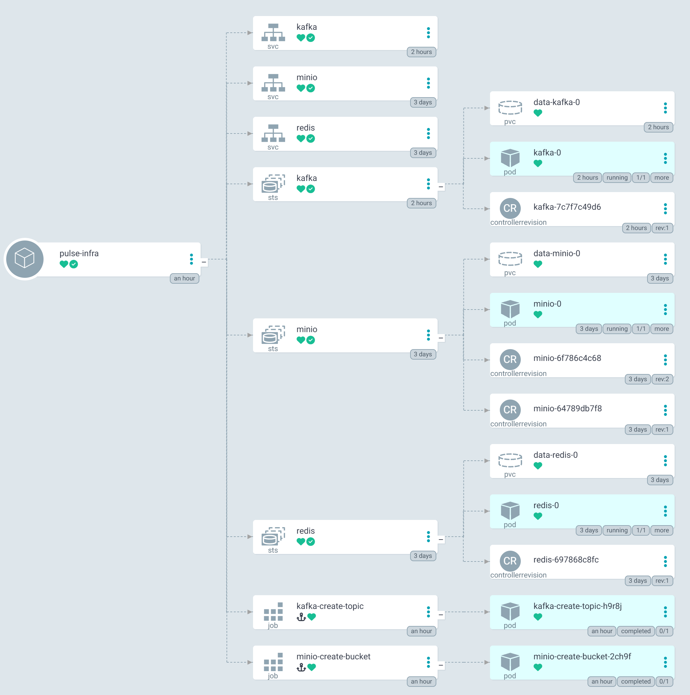

# Pulse

An event ingestion pipeline, run on Kubernetes and deployed with GitOps.

Clients send events (page views, clicks, purchases) to an HTTP api. The api writes them to Kafka. Workers read them from Kafka, keep live counts in Redis, and save the raw events as files in S3-compatible storage. Every change, to the code or to the cluster, goes through a pull request, CI and Git.



*The demo page served by the api: send events, watch the counts update. The version in the corner is the image tag that's running.*

## Architecture





## How it works

### The data path

1. **api** (Fastify, TypeScript) validates each event and publishes it to the Kafka topic `events.raw`, keyed by `userId`, so one user's events stay in order on one partition. It replies `202` only after Kafka has acknowledged the write (`acks=all`), and `503` with `Retry-After` if Kafka is unavailable.
2. **Kafka** (single broker, KRaft mode) holds the events. The topic has 3 partitions, so up to 3 workers can share the work.
3. **workers** form one consumer group, so Kafka splits the partitions between them. For each batch they:
   - add to the per-type counts in Redis (one pipelined round trip),
   - buffer the events and write them to object storage as one NDJSON file, after 500 events or a time limit (10 s in the cluster),
   - **commit the Kafka offset only after the file is written.** A crash means some events are processed again, never lost (at-least-once).
4. **`GET /stats`** reads the counts from Redis.

Stored files are partitioned by date and hour, ready for a query engine such as Athena:

```
raw/dt=2026-11-26/hour=17/d7e0c138-16b8-4d48-b641-f32763e35f12.ndjson
{"type":"click","userId":"user-5","props":{"source":"demo"},"id":"8083716a-…","receivedAt":"2026-11-26T17:57:20.988Z"}
```

### The delivery path

Build and deploy are separate steps:

| Step | What happens | Where |
|---|---|---|
| 1. Pull request | CI runs lint, typecheck, unit tests and builds both Docker images; Trivy fails the build on fixable critical vulnerabilities | [ci.yaml](.github/workflows/ci.yaml) |
| 2. Merge to `main` | `main` is protected: the CI checks must pass. The release workflow builds both images and pushes them to GHCR, tagged with the commit SHA | [release.yaml](.github/workflows/release.yaml) |
| 3. Release PR | Change `image.tag` in `values-dev.yaml` to that SHA. The api and the worker share the tag, so they're always deployed at the same version | [values-dev.yaml](deploy/helm/pulse/values-dev.yaml) |
| 4. Sync | ArgoCD sees the change in Git and rolls the pods: a new api pod must pass its readiness check before an old one is removed | [deploy/argocd/](deploy/argocd/) |

Rollback is `git revert` of the release PR. The old image is still in GHCR, so nothing is rebuilt.



ArgoCD runs two Applications, each watching its own folder:

| Application | Source | Deploys |
|---|---|---|
| `pulse` | [deploy/helm/pulse/](deploy/helm/pulse/), a Helm chart | api Deployment and Service, worker Deployment, ConfigMap, PodDisruptionBudget |
| `pulse-infra` | [deploy/infra/](deploy/infra/), plain manifests | Kafka, Redis and MinIO StatefulSets with persistent volumes; topic and bucket creation as PostSync hook Jobs |





## Tech stack

| Area | Tools |
|---|---|
| Services | Node.js 24, TypeScript, Fastify, KafkaJS, ioredis, AWS SDK v3 (S3), zod, pino, prom-client |
| Data | Kafka 4.4 (KRaft), Redis 7.4, MinIO (S3-compatible) |
| Tests and quality | Vitest, ESLint, Prettier |
| Containers | Multi-stage Dockerfiles, non-root user, read-only root filesystem |
| Kubernetes | kind (3 nodes), Helm, probes, resource limits, rolling updates, PodDisruptionBudget |
| CI/CD | GitHub Actions, GHCR, Trivy, branch protection, ArgoCD (automated sync, prune, self-heal) |
| Cloud | Terraform for an S3 bucket and a least-privilege IAM user on AWS ([terraform/](terraform/)) |

## Repository layout

```
apps/api/             HTTP api: validation, Kafka producer, /stats, /metrics, demo page
apps/worker/          Kafka consumer: Redis counts, S3 files, commit after write
packages/shared/      Event schema and config shared by both apps
deploy/compose.yaml   Whole stack in Docker Compose, for local development
deploy/kind/          kind cluster definition
deploy/helm/pulse/    Helm chart for the api and the worker
deploy/infra/         Kafka, Redis, MinIO manifests
deploy/argocd/        The two ArgoCD Applications
terraform/            AWS S3 bucket and IAM
.github/workflows/    CI and release
JOURNAL.md            Day-by-day build log: decisions, problems, drills
```

## Run it

### Option 1: Docker Compose (quickest)

Needs Docker Desktop.

```sh
cp deploy/.env.example deploy/.env    # then choose your own MinIO password
docker compose -f deploy/compose.yaml up -d --build
```

Open http://localhost:3000. Compose builds the images from your local code.

### Option 2: Kubernetes with ArgoCD (the full setup)

Needs Docker Desktop (about 6 GB of memory), `kind`, `kubectl` and `helm`.

```sh
# 1. Cluster
kind create cluster --config deploy/kind/kind.yaml
kubectl create namespace pulse

# 2. ArgoCD
kubectl create namespace argocd
kubectl apply -n argocd --server-side -f https://raw.githubusercontent.com/argoproj/argo-cd/v3.6.3/manifests/install.yaml

# 3. Secrets (never stored in Git). Use the same values in both.
kubectl create secret generic minio-credentials -n pulse \
  --from-literal=rootUser=<user> --from-literal=rootPassword=<password>
kubectl create secret generic pulse-s3 -n pulse \
  --from-literal=AWS_ACCESS_KEY_ID=<user> --from-literal=AWS_SECRET_ACCESS_KEY=<password>

# 4. Hand everything else to ArgoCD
kubectl apply -f deploy/argocd/infra-application.yaml
kubectl apply -f deploy/argocd/application.yaml

# 5. Open the api
kubectl port-forward -n pulse svc/pulse 3000:80
```

The MinIO password must be at least 8 characters and URL-safe. ArgoCD deploys from this repository's `main` branch; to deploy your own changes, fork it and change `repoURL` in both Applications.

## Design decisions

- **Kafka between the api and the workers.** The api stays fast and available when workers are slow or down: events wait in Kafka, and workers catch up from their last committed offset.
- **Commit after write.** Offsets are committed only after the S3 file exists. Duplicates are possible, data loss is not.
- **Partition key = `userId`.** Keeps each user's events in order, and spreads users across partitions.
- **Image tag = commit SHA.** Tags never change, so Git always says exactly which code runs, and rollback is a revert.
- **Dependencies behind small interfaces** (`EventPublisher`, `StatsReader`). Unit tests use fakes, so CI needs no Kafka or Redis.
- **Data services separate from the app** (`pulse-infra` vs `pulse`). The app is redeployed often, the data services rarely.

## Known limitations and next steps

- **Secrets are created by hand.** Next: Sealed Secrets or External Secrets, so they can live in Git safely.
- **Releases are a manual PR.** Next: the release workflow opens the tag-bump PR itself (needs a GitHub App token, because PRs opened with `GITHUB_TOKEN` don't trigger CI).
- **Monitoring.** The api exposes Prometheus metrics (request rate, errors, latency histogram) at `/metrics`, but nothing scrapes them yet. Next: kube-prometheus-stack, a Grafana dashboard and an error-rate alert.
- **Single Kafka broker** with replication factor 1: fine locally, not fault-tolerant.
- **No worker liveness probe.** The worker exits on errors and Kubernetes restarts it, but a hung worker wouldn't be noticed.
- **At-least-once counts.** After a crash, Redis counts can be slightly too high. Fix: de-duplicate by event id.
- **KafkaJS is no longer maintained.** Alternative: `@confluentinc/kafka-javascript`.
- **The api has no authentication.** It's a local demo.

See [JOURNAL.md](JOURNAL.md) for how each part was built, including failure drills (killed workers, bad images, rollbacks, drift).
